# TaskHive

[](https://github.com/Yam0r/TaskHive/actions/workflows/ci.yml)

REST API for project and task management: users create projects, add tasks with labels and
deadlines, discuss them in comments and attach files stored in Dropbox.

Frontend (Angular): [TaskHive-frontend](https://github.com/Yam0r/TaskHive-frontend)

---

## Highlights

- **Ownership-based access control.** Every project, task, comment and attachment is visible
  only to its owner; requests for someone else's data return `404`, so IDs can't be probed.
- **Stateless JWT authentication** with Spring Security, BCrypt-hashed passwords and
  role-based endpoints (`USER` / `ADMIN`).
- **136 automated tests**: unit tests with Mockito and integration tests against a real
  PostgreSQL in Docker via Testcontainers.
- **CI on GitHub Actions**: every pull request runs Checkstyle and the full test suite;
  `main` accepts changes only through a pull request with a green build.
- **Database migrations with Liquibase**, including cascade rules for related data.
- **Production-ready Docker image**: multi-stage build, JRE-only runtime, non-root user,
  no secrets baked in.
- **Consistent error responses** via a global exception handler (`400`, `401`, `403`,
  `404`, `409`).

---

## Tech Stack

| Area | Technology |
|---|---|
| Language | Java 21 |
| Framework | Spring Boot 3.5 (Web, Security, Data JPA, Validation) |
| Database | PostgreSQL 17, Liquibase |
| Auth | JWT (jjwt 0.12) |
| Mapping | MapStruct, Lombok |
| File storage | Dropbox SDK |
| API docs | springdoc-openapi (Swagger UI) |
| Testing | JUnit 5, Mockito, MockMvc, Testcontainers |
| Build & CI | Maven, Checkstyle, GitHub Actions |
| Containers | Docker, Docker Compose |

---

## API

All endpoints are prefixed with `/api`. Everything except registration and login requires
a `Authorization: Bearer <token>` header.

Full interactive documentation is available in Swagger UI once the app is running:
`/api/swagger-ui/index.html`.

### Auth
| Method | Endpoint | Description |
|---|---|---|
| POST | `/auth/registration` | Register a new user |
| POST | `/auth/login` | Log in and receive a JWT |

### Users
| Method | Endpoint | Description |
|---|---|---|
| GET | `/users/me` | Current user's profile |
| PUT | `/users/me` | Update current user's profile |
| PUT | `/users/{id}/role` | Change a user's role (**admin only**) |

### Projects
| Method | Endpoint | Description |
|---|---|---|
| POST | `/projects` | Create a project |
| GET | `/projects` | List my projects (paginated) |
| GET | `/projects/{id}` | Project details |
| PUT | `/projects/{id}` | Update a project |
| DELETE | `/projects/{id}` | Delete a project with all its tasks |

### Tasks
| Method | Endpoint | Description |
|---|---|---|
| POST | `/tasks` | Create a task in my project |
| GET | `/tasks?projectId={id}` | Tasks of a project (paginated) |
| GET | `/tasks/{id}` | Task details |
| PUT | `/tasks/{id}` | Update a task |
| DELETE | `/tasks/{id}` | Delete a task |
| GET | `/tasks/my` | Tasks assigned to me |
| GET | `/tasks/my/statistics` | My task counts by status |
| POST | `/tasks/{taskId}/labels/{labelId}` | Add a label to a task |
| DELETE | `/tasks/{taskId}/labels/{labelId}` | Remove a label from a task |

### Comments
| Method | Endpoint | Description |
|---|---|---|
| POST | `/comments` | Comment on a task (author is taken from the token) |
| GET | `/comments?taskId={id}` | Comments of a task (paginated) |

### Attachments
| Method | Endpoint | Description |
|---|---|---|
| POST | `/attachments` | Upload a file to a task (multipart, stored in Dropbox) |
| GET | `/attachments?taskId={id}` | Attachments of a task (paginated) |

### Labels
| Method | Endpoint | Description |
|---|---|---|
| POST | `/labels` | Create a label |
| GET | `/labels` | List labels |
| PUT | `/labels/{id}` | Update a label |
| DELETE | `/labels/{id}` | Delete a label |

Paginated endpoints accept `page`, `size` and `sort` (e.g. `sort=name,desc`).

---

## Database Schema

<picture>
  <source media="(prefers-color-scheme: dark)" srcset="docs/erd-dark.svg">
  
</picture>

---

## Running Locally

### Prerequisites
- Docker and Docker Compose
- Java 21 (only to run the app or tests outside Docker)

### 1. Clone the repository
```bash
git clone https://github.com/Yam0r/TaskHive.git
cd TaskHive
```

### 2. Create a `.env` file in the project root
```dotenv
POSTGRES_USER=taskhive
POSTGRES_PASSWORD=taskhive
POSTGRES_DB=taskhive

# Secret for signing JWTs: a long random string, e.g. `openssl rand -base64 64`
JWT_SECRET=change-me-to-a-long-random-string

# Optional: needed only for file uploads
MY_APP_NAME=TaskHive
MY_DROPBOX_ACCESS_TOKEN=
```

### 3. Start the database and the application
```bash
docker compose up --build
```

The API is available at `http://localhost:8081/api`,
Swagger UI at `http://localhost:8081/api/swagger-ui/index.html`.

### Running from the IDE
Start only the database with `docker compose up -d postgres`, then run `TaskHiveApplication`.
The app reads `.env` automatically and listens on `http://localhost:8080/api`.

### Running the tests
```bash
./mvnw verify
```
Docker must be running: integration tests start PostgreSQL via Testcontainers.